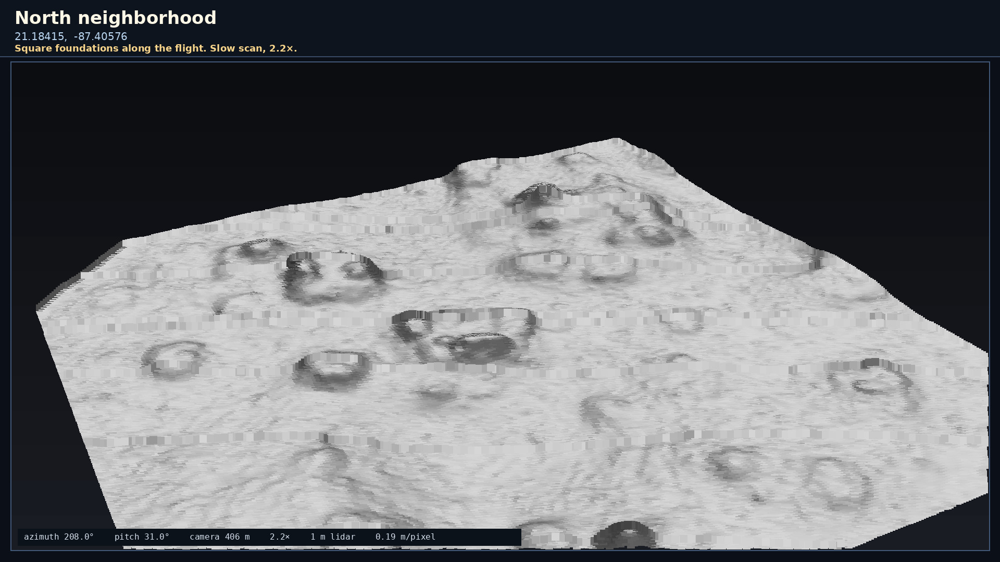
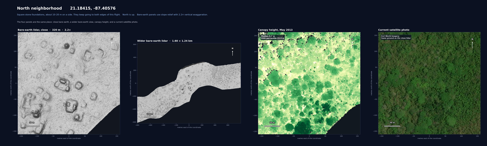
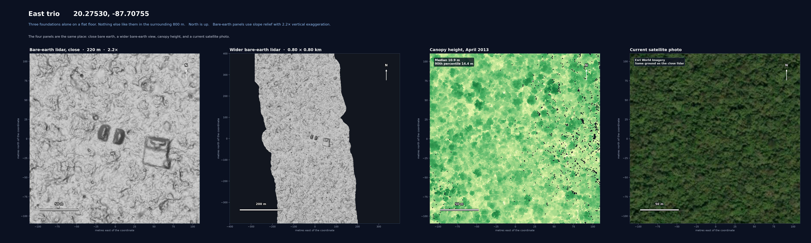
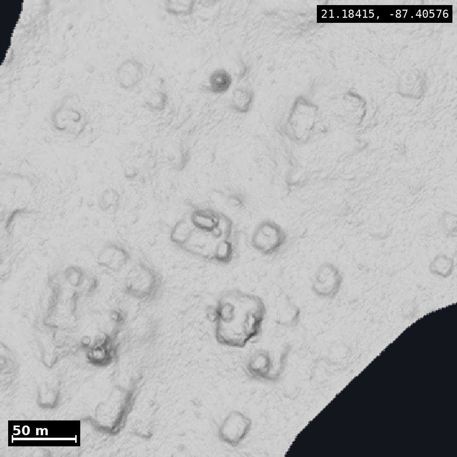
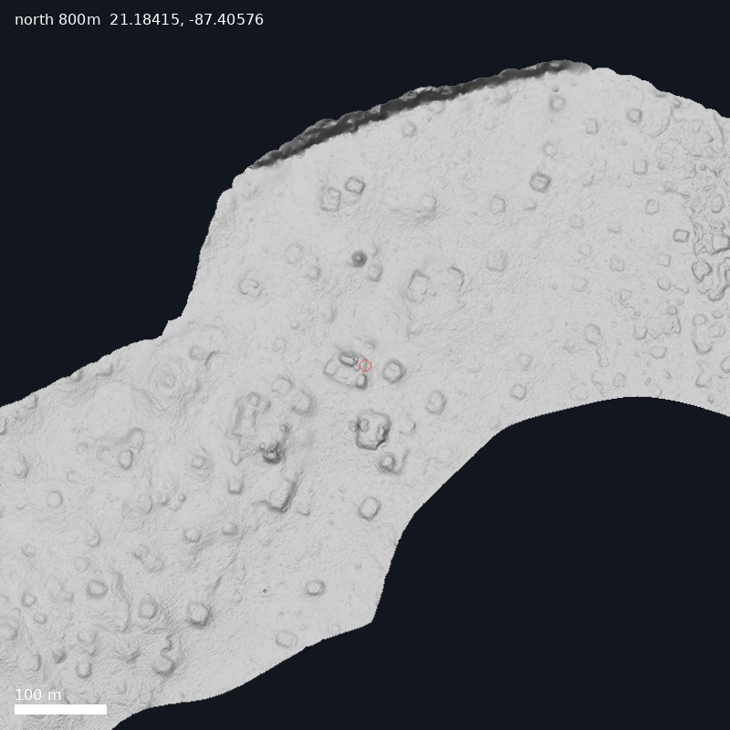
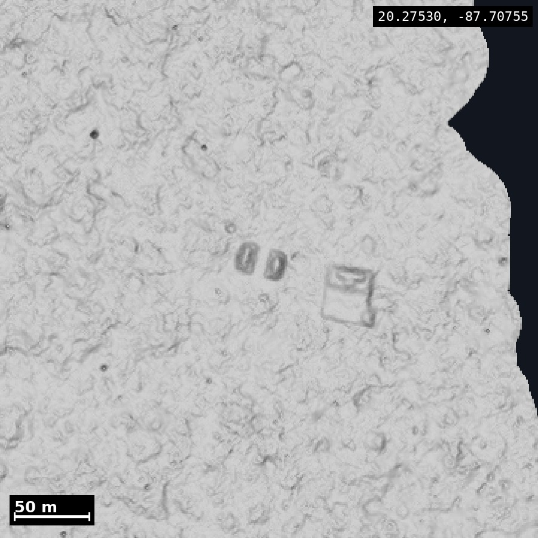
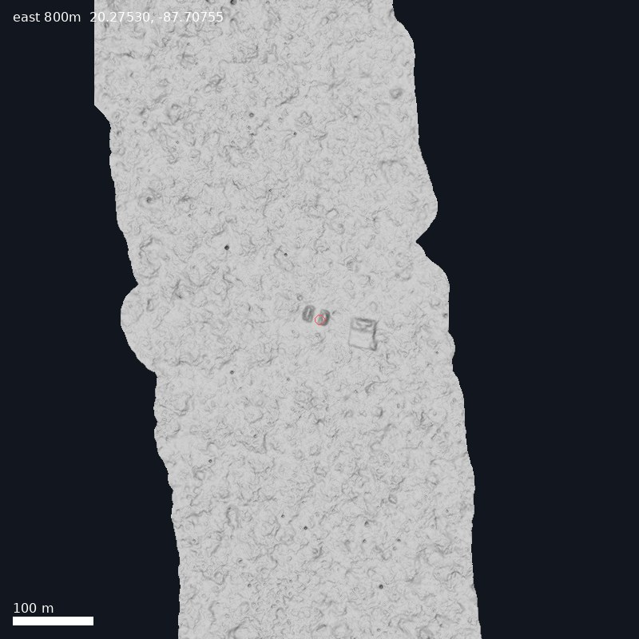

# Two unnamed groups under closed canopy in Quintana Roo

Two unnamed groups of stone foundations in Quintana Roo, still under closed canopy, seen on the November 2026 bare-earth lidar.

## Scan

[Watch the scan](media/hidden-ruins-unnamed-scan.mp4)

The scan and the sheets are renderings of the bare-earth grid. The green panel on each sheet is the 2013 canopy-height product. The photo beside it is the forest that is still standing.

## North neighborhood

**21.18420, -87.40593** · [Google Maps](https://www.google.com/maps?q=21.18420,-87.40593)

The sheet is centered on 21.18415, -87.40576. That point is the eastern foot of a brace. The coordinate above is the top of the same brace, 18 m to the west-northwest.

## East trio

**20.27530, -87.70755** · [Google Maps](https://www.google.com/maps?q=20.27530,-87.70755)

## Closer views

North patio. Square braces, seen at an angle. The label in the corner is the center the picture was drawn from.

The same neighborhood. The braces keep going across the strip. The red circle is 21.18415, -87.40576.

The east group: two parallel rectangles and a square with a wall across the inside.

The same three, alone on a flat floor. The red circle is the map pin.

## North neighborhood

[21.18420, -87.40593](https://www.google.com/maps?q=21.18420,-87.40593). Yalahau region, northern Quintana Roo, on strip `OutYuc_NFI_l0s413`.

NASA G-LiHT flew the strip in May 2013. The ground you see is Britton’s November 2026 1 m bare-earth grid on OpenTopography, collection [OT.112026.32616.1](https://doi.org/10.5069/G9TH8JX9). On that grid the published pin sits on a square brace about 2 m above the ground beside it. Braces like it, about 10–20 m on a side, continue to both edges of the flight. The flight is only about 1.2 km across. There is no pyramid in the slice.

The pictures were drawn around 21.18415, -87.40576. Sampled on the 1 m grid, that cell is the eastern foot of the brace (9.7 m elevation, essentially level with the slope). The map pin is the top of that brace, 21.18420, -87.40593, 18 m west-northwest, at 12.4 m elevation.

The May 2013 canopy-height grid around the group has a median near 10 m. The pin is north of Kantunilkín. The town center is at 21.10 N, 87.49 W, and the pin is 12.5 km to its northeast.

The nearest named dot in Florencia Müller’s 1959 Atlas arqueológico de Quintana Roo is Chanchen, 7.0 km southwest, a rank-4 point. That is not the modern village Chanchen Primero near Tulum (20.40 N, 87.97 W). In the Glover and Amador Yalahau survey, the nearest site in the EAAMS copy is Site 27, 13.6 km north. The atlas point Kantunil Kin is about 14 km southwest. No paper maps this coordinate.

## East trio

[20.27530, -87.70755](https://www.google.com/maps?q=20.27530,-87.70755). Strip `North2_GLAS_l3s458`. Same 2013 lasers, flown in April 2013, and the same November 2026 bare-earth grid.

Three foundations sit on a flat floor. Two are parallel rectangles. The third is a square with an interior wall, about 55 m east of the pair. The map pin is on the eastern rectangle. The crests stand about 2.5 m above the floor. Nothing else of this shape shows in the surrounding 800 m.

The April 2013 canopy-height grid has a median of about 10.9 m. The pin is 24.8 km due south of Coba (the monument area is about 20.498 N, 87.710 W), almost on the same longitude. It is outside the Stanton and Ardren Coba–Yaxuna lidar, which covers the city and the causeway to the west. The nearest named atlas points are 15–16 km away: Santo Domingo, San Juan, and Bolludo. The Coba outlier groups in Robles Castellanos 1990, Macanxoc and the others, are 19–23 km north. Muyil is about 24 km southeast. No paper maps this coordinate.

## What the catalogs already said

Schroder, Murtha, Golden, Anaya Hernández, and Scherer 2020, in the Journal of Archaeological Science: Reports, annotated archaeological features on all 458 Maya G-LiHT tiles, including both of these strips, and they published counts. They did not name either group, and they did not publish a coordinate for either one.

Britton’s 2026 structure catalog counts structures across the Out and North2 regions. It does not name either group.

The public MARI structure-polygon layer is the southern Campeche and Quintana Roo campaign. It stops near 19.9 N. A query at both pins returns nothing.

These coordinates were found by scanning Britton’s November 2026 bare-earth grids, not by reading his catalog.
